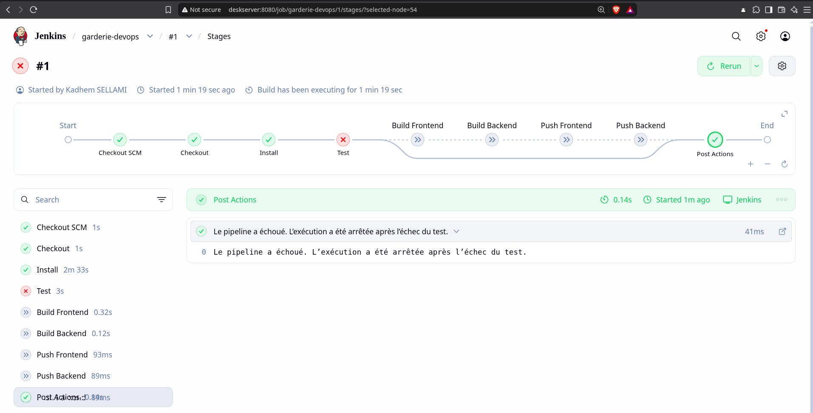

# Ma Garderie DevOps

Application web de démonstration pour une garderie d'enfants, développée avec Next.js côté frontend et Express côté backend, puis conteneurisée avec Docker,
provisionnée via Vagrant + Ansible, et intégrée dans un pipeline Jenkins.

## Présentation

La solution expose une landing page responsive qui présente la garderie, ses services et ses activités. Le frontend consomme les API REST du backend pour afficher les informations dynamiquement.

## Technologies utilisées

- Frontend : Next.js, React
- Backend : Node.js, Express
- Tests frontend : Jest + Testing Library
- Conteneurisation : Docker, Docker Compose
- CI/CD : Jenkins Pipeline as Code
- Infrastructure : Vagrant + Ansible
- Hébergement cible : Ubuntu Server dans une VM Vagrant

## Architecture

- Frontend : interface utilisateur responsive pour la landing page
- Backend : API REST exposant les données de la garderie
- Docker Compose : orchestration locale des services
- Jenkins : build, test, build Docker, push vers Docker Hub
- Vagrant + Ansible : création et provisionnement de la VM Ubuntu

## Structure du projet

```text
.
├── backend/
│   ├── Dockerfile
│   ├── package.json
│   └── server.js
├── frontend/
│   ├── app/
│   ├── Dockerfile
│   ├── __tests__/
│   ├── jest.config.js
│   ├── jest.setup.js
│   ├── next.config.mjs
│   ├── package.json
│   └── app/page.js
├── ansible/
│   ├── ansible.cfg
│   ├── inventory.ini
│   ├── site.yml
│   └── roles/docker/
│       ├── defaults/
│       ├── handlers/
│       └── tasks/
├── Jenkinsfile
├── docker-compose.yml
├── Vagrantfile
├── .gitignore
├── README.md
└── content.md
```

## Démarrage local sans installation sur la machine hôte

Les dépendances sont déclarées dans les fichiers package.json, mais elles ne sont pas installées dans cet environnement de travail. Pour les exécuter sur une machine de développement, il faut installer les dépendances avec la commande habituelle du projet (par exemple npm install dans chaque dossier) puis lancer les services.

## API backend

- GET /api/garderie
- GET /api/services
- GET /api/activites

## Pipeline Jenkins

Le fichier Jenkinsfile à la racine indique les étapes suivantes :

1. Checkout du dépôt GitHub
2. Installation des dépendances
3. Exécution du test frontend
4. Construction de l'image Docker frontend
5. Construction de l'image Docker backend
6. Push des images sur Docker Hub
7. Arrêt immédiat en cas d'échec du test

Configurer les identifiants Docker Hub dans la gestion des credentials Jenkins avec l'ID attendu par le pipeline : dockerhub-creds.

## Vagrant et Ansible

Le Vagrantfile crée une VM Ubuntu Server avec 2 Go RAM et 2 vCPU, sur le réseau privé 192.168.56.10.

Le provisionnement Ansible installe Docker Engine, le plugin Docker Compose, active le service Docker et ajoute l'utilisateur vagrant au groupe docker.

## Déploiement avec Docker Compose

```bash
docker compose up -d --build
```

Puis accéder à :

- Frontend : http://localhost:3000
- Backend : http://localhost:4000/api/garderie

## Docker Hub

Remplacer les valeurs ci-dessous par les bonnes références publiques Docker Hub :

- Frontend : username/garderie-frontend
- Backend : username/garderie-backend

## Accès à l'application déployée

Dans la VM Vagrant, l'application est accessible sur le port 3000 exposé par le frontend.

## Captures d'écran

### Interromption de Pipeline Jenkins



### Pipeline Jenkins réussi


### Images publiées sur Docker Hub


### VM Vagrant démarrée


### Provisionnement Ansible réussi


### Conteneurs Docker actifs


### Application accessible depuis le navigateur


## Dépôt GitHub

Le dépôt public doit contenir l'ensemble du code source, le Jenkinsfile, Dockerfiles, Vagrantfile, configuration Ansible, fichiers Docker Compose et la documentation.
